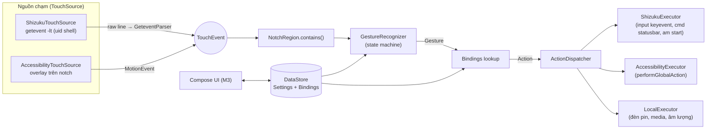
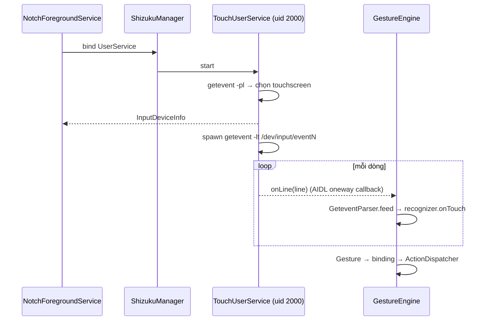

# 02 — Thiết kế hệ thống

> Trạng thái: **Đã chốt v1.0** · Liên quan: [01-requirements.md](01-requirements.md)

## 1. Tổng quan



Nguyên tắc:
1. **Lõi thuần Kotlin** (`:core`, JVM library, không phụ thuộc Android) chứa toàn bộ logic quyết định → test nhanh bằng JUnit, phục vụ TDD.
2. **`:app`** chỉ là "adapter": nối Android API (Shizuku, Accessibility, CameraManager, DataStore, Compose) vào các interface của lõi.
3. Không có trạng thái toàn cục; mọi thời gian đi qua tham số `timeMs` để test được.

## 2. Module & package

```
totch/
├── core/                         # Kotlin JVM library — KHÔNG import android.*
│   └── src/main/kotlin/io/github/ptt98hd/totch/core/
│       ├── model/                # TouchEvent, Gesture, Action, Rect, Settings, Bindings
│       ├── gesture/              # GestureRecognizer, GestureConfig
│       ├── input/                # GeteventParser, InputDeviceInfo, CoordinateMapper
│       ├── region/               # NotchRegionResolver
│       ├── action/               # ActionDispatcher, ActionExecutor, ShellCommands
│       └── settings/             # SettingsCodec (JSON), validation/clamp
├── app/                          # Android application
│   └── src/main/java/io/github/ptt98hd/totch/
│       ├── TotchApp.kt
│       ├── data/                 # SettingsRepository (DataStore)
│       ├── engine/               # GestureEngine: nối TouchSource → recognizer → dispatcher
│       ├── shizuku/              # ShizukuManager, TouchUserService (AIDL), ShizukuExecutor
│       ├── accessibility/        # NotchAccessibilityService, AccessibilityExecutor
│       ├── service/              # NotchForegroundService, BootReceiver
│       ├── action/               # LocalExecutor (torch, media, volume), AppLauncher
│       └── ui/                   # theme/, home/, gestures/, settings/, about/, navigation
└── docs/
```

## 3. Hợp đồng API của `:core` (nguồn chân lý cho test)

```kotlin
package io.github.ptt98hd.totch.core.model

data class Rect(val left: Int, val top: Int, val right: Int, val bottom: Int) {
    val width: Int get() = right - left
    val height: Int get() = bottom - top
    fun contains(x: Float, y: Float): Boolean   // left <= x < right && top <= y < bottom
    fun inset(by: Int): Rect                    // âm = mở rộng
}

enum class TouchAction { DOWN, MOVE, UP, CANCEL }
data class TouchEvent(val action: TouchAction, val x: Float, val y: Float,
                      val timeMs: Long, val pointerCount: Int = 1)

enum class Gesture { TAP, DOUBLE_TAP, LONG_PRESS, SWIPE_DOWN, SWIPE_LEFT, SWIPE_RIGHT }

@Serializable sealed interface Action {
    @Serializable @SerialName("none")          data object None : Action
    @Serializable @SerialName("back")          data object Back : Action
    @Serializable @SerialName("home")          data object Home : Action
    @Serializable @SerialName("recents")       data object Recents : Action
    @Serializable @SerialName("lock")          data object LockScreen : Action
    @Serializable @SerialName("screenshot")    data object Screenshot : Action
    @Serializable @SerialName("notifications") data object Notifications : Action
    @Serializable @SerialName("quick_settings")data object QuickSettings : Action
    @Serializable @SerialName("torch")         data object ToggleTorch : Action
    @Serializable @SerialName("play_pause")    data object MediaPlayPause : Action
    @Serializable @SerialName("next")          data object MediaNext : Action
    @Serializable @SerialName("previous")      data object MediaPrevious : Action
    @Serializable @SerialName("volume_up")     data object VolumeUp : Action
    @Serializable @SerialName("volume_down")   data object VolumeDown : Action
    @Serializable @SerialName("launch_app")    data class LaunchApp(val packageName: String) : Action
}
```

```kotlin
package io.github.ptt98hd.totch.core.gesture

data class GestureConfig(
    val doubleTapMs: Long = 300, val longPressMs: Long = 500,
    val touchSlopPx: Float = 24f, val swipeMinDistancePx: Float = 60f,
    val doubleTapEnabled: Boolean = true,   // false => FR-G5: TAP phát ngay khi UP
)

class GestureRecognizer(config: GestureConfig, private val region: () -> Rect?) {
    var config: GestureConfig                  // thay được lúc chạy (FR-S3)
    fun onTouch(event: TouchEvent): List<Gesture>
    fun onTick(nowMs: Long): List<Gesture>      // gọi theo deadline để xử lý timeout
    fun nextDeadlineMs(): Long?                 // thời điểm cần gọi onTick kế tiếp, null = không cần
    fun reset()
}
```

```kotlin
package io.github.ptt98hd.totch.core.input

data class AbsRange(val min: Int, val max: Int)
data class InputDeviceInfo(val path: String, val name: String, val x: AbsRange, val y: AbsRange, val direct: Boolean)

object GeteventDeviceParser { fun parse(getEventPlOutput: String): List<InputDeviceInfo>  // từ `getevent -pl`
                              fun pickTouchscreen(devices: List<InputDeviceInfo>): InputDeviceInfo? }

class GeteventParser(private val mapper: CoordinateMapper) {
    fun feed(line: String): List<TouchEvent>    // từng dòng của `getevent -lt <device>`
}

class CoordinateMapper(device: InputDeviceInfo, screenWidthPx: Int, screenHeightPx: Int) {
    fun map(rawX: Int, rawY: Int): Pair<Float, Float>
}
```

```kotlin
package io.github.ptt98hd.totch.core.region

data class Cutout(val boundingRectsTop: List<Rect>)  // rects ở cạnh trên do Android cung cấp
data class ManualRegion(val centerXFraction: Float, val widthPx: Int, val heightPx: Int)

object NotchRegionResolver {
    fun resolve(screenWidthPx: Int, statusBarHeightPx: Int, cutout: Cutout?,
                manual: ManualRegion?, paddingPx: Int, rotation: Int): Rect?   // null = tắt (FR-R4)
}
```

```kotlin
package io.github.ptt98hd.totch.core.action

enum class Capability { SHIZUKU, ACCESSIBILITY, LOCAL }

interface ActionExecutor {
    val capability: Capability
    fun isAvailable(): Boolean
    fun supports(action: Action): Boolean
    suspend fun execute(action: Action): Result<Unit>
}

object ActionRequirements { fun of(action: Action): Set<Capability> }  // tập backend có thể chạy

class ActionDispatcher(executors: List<ActionExecutor>) {
    // Ưu tiên: LOCAL > ACCESSIBILITY > SHIZUKU. None → Skipped, không gọi executor.
    suspend fun dispatch(action: Action): DispatchResult
}
sealed interface DispatchResult { data object Ok; data object Skipped; data class Failed(val reason: String) }

object ShellCommands { fun of(action: Action): String?                          // lệnh shell cho ShizukuExecutor
                       fun launch(packageName: String, activityName: String): String? }  // null nếu tên không hợp lệ
```

```kotlin
package io.github.ptt98hd.totch.core.settings

enum class DetectionMode { SHIZUKU, ACCESSIBILITY }

@Serializable data class Settings(
    val enabled: Boolean = false,
    val mode: DetectionMode = DetectionMode.ACCESSIBILITY,
    val bindings: Map<Gesture, Action> = DefaultBindings,
    val doubleTapMs: Long = 300, val longPressMs: Long = 500,
    val swipeMinDistanceDp: Int = 40, val paddingDp: Int = 8,
    val manualRegion: ManualRegionDp? = null,
    val haptics: Boolean = true,
) { fun sanitized(): Settings }   // clamp theo FR-S4

object SettingsCodec { fun encode(s: Settings): String; fun decode(json: String): Settings } // lỗi → mặc định
```

## 4. Luồng chính

### 4.1 Shizuku mode

- `TouchUserService` chạy trong process của Shizuku với uid shell; giao tiếp qua AIDL
  `ITouchService { void start(ILineCallback cb); void stop(); int exec(String cmd); destroy() }` và
  `oneway ILineCallback { onDevice(path, name, minX, maxX, minY, maxY); onLines(String[] frame); onError(int) }`
  (mỗi lần gọi `onLines` chứa các dòng của một khung, tới `SYN_REPORT`).
- `ShizukuExecutor.execute` gọi `exec("input keyevent 4")` …
- Shizuku binder chết → engine chuyển trạng thái `WAITING_SHIZUKU`, lắng nghe `OnBinderReceivedListener` để tự kết nối lại (NFR-8).

### 4.2 Accessibility mode
- `NotchAccessibilityService.onServiceConnected` thêm một `View` trong suốt kiểu
  `TYPE_ACCESSIBILITY_OVERLAY`, đặt đúng `Rect` vùng notch, `FLAG_NOT_FOCUSABLE | FLAG_LAYOUT_IN_SCREEN`,
  `layoutInDisplayCutoutMode = ALWAYS`.
- `onTouchEvent(MotionEvent)` → chuyển thành `TouchEvent` tọa độ màn hình (`rawX/rawY`) → engine.
- Khi xoay màn hình / settings thay đổi → tính lại `Rect`, cập nhật `LayoutParams`; `null` → ẩn overlay.
- Service không khai báo `canRetrieveWindowContent`, không lắng nghe event nào (`eventTypes` rỗng).

### 4.3 Hẹn giờ cho recognizer
`GestureEngine` sau mỗi `onTouch/onTick` đọc `nextDeadlineMs()` và đặt lại một coroutine `delay`
duy nhất trên `Dispatchers.Default` → không polling (NFR-3).

## 5. Lưu trữ
- Một key DataStore Preferences `settings_json` chứa `SettingsCodec.encode(settings)`.
- `SettingsRepository.settings: Flow<Settings>` (đã `sanitized()`), `suspend fun update(transform)`.

## 6. Quyền & thành phần manifest
| Thành phần | Mục đích |
|---|---|
| `FOREGROUND_SERVICE`, `FOREGROUND_SERVICE_SPECIAL_USE` | Service Shizuku mode |
| `POST_NOTIFICATIONS` | Thông báo thường trực |
| `RECEIVE_BOOT_COMPLETED` | FR-D6 |
| `VIBRATE` | FR-A10 |
| `QUERY_ALL_PACKAGES` → **không dùng**; thay bằng `<queries>` intent MAIN/LAUNCHER | App picker |
| `BIND_ACCESSIBILITY_SERVICE` (service) | Accessibility mode |
| Shizuku `ShizukuProvider` | Theo yêu cầu thư viện Shizuku |
| `MediaListenerService` (`BIND_NOTIFICATION_LISTENER_SERVICE`, tùy chọn) | Điều khiển media qua `MediaController` (actions spec §5); không đọc thông báo |
| Không có `INTERNET` | NFR-4 |

## 7. Stack & phiên bản
| Thành phần | Phiên bản |
|---|---|
| JDK | Temurin 17 (qua `mise.toml`) |
| Gradle / AGP | wrapper 9.8.2 / AGP 9.4.1 (Kotlin tích hợp sẵn của AGP 9) · compileSdk 37 |
| Kotlin | 2.4.21, kotlinx-serialization 1.12, coroutines 1.11 |
| UI | Compose BOM mới nhất, Material 3, Navigation Compose |
| Shizuku | `dev.rikka.shizuku:api` + `provider` 13.1.5 (Apache-2.0, hợp lệ với F-Droid) |
| Test | JUnit 4, kotlin-test, kotlinx-coroutines-test, Turbine |

## 8. ADR (quyết định kiến trúc)
- **ADR-1 Hai chế độ nhận chạm** — status bar nằm trên overlay thường nên chỉ có 2 cách khả thi
  không cần root: đọc input thô (Shizuku) hoặc overlay accessibility. Mỗi cách có đánh đổi
  (R2/R3) → để người dùng chọn.
- **ADR-2 `:core` thuần JVM** — cho phép TDD nhanh (< 5 s), không cần emulator.
- **ADR-3 Settings lưu JSON trong 1 key** — schema đơn giản, migrate dễ, giải mã lỗi thì về mặc định.
- **ADR-4 minSdk 31** — dynamic color luôn có; `WindowMetrics`/`DisplayCutout` ổn định.
